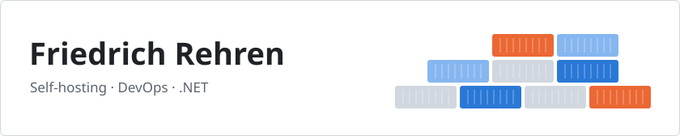

  <picture>
    <source media="(prefers-color-scheme: dark)" srcset="assets/header-dark.svg">
    
  </picture>

Hi 👋 Self-hosting is my thing: I run way too many containers at home and build the tools around them.

- 🏠 Small self-hosted services and tools for calendars, media and Home Assistant.
- 🐳 Container images for open-source tools that follow upstream releases on their own.
- ⚙️ Mostly C# and .NET, glued together with shell scripts and GitHub Actions.

  <a href="https://hub.docker.com/u/friedrichrehren">
    <picture>
      <source media="(prefers-color-scheme: dark)" srcset="https://raw.githubusercontent.com/FriedrichRehren/FriedrichRehren/output/stats-dark.svg">
      
    </picture>
  </a>

